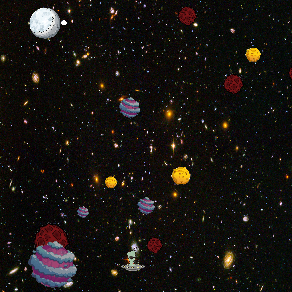

# Jeu spatial — C++ / Grapic 🚀

**Mini-projet universitaire — Licence 1 Informatique, Université Claude Bernard Lyon 1**

## Présentation

Jeu/simulation 2D dans lequel le joueur dirige un petit vaisseau (alien) vers la Lune en évitant des rochers mobiles. L'objectif est d'atteindre la Lune sans heurter les obstacles ni sortir de l'écran.

## Fonctionnalités

- Contrôle du mouvement du vaisseau à l'aide du clic gauche de la souris.
- Déplacement horizontal des rochers et gestion des obstacles.
- Calcul des positions et vitesses à l'aide de vecteurs.
- Détection des collisions et des conditions de réussite/échec.
- Score : **+10** lorsqu'on atteint la Lune, **-5** en cas de collision ou de sortie de l'écran.

## Technologies et notions abordées

- **C++**
- Bibliothèque graphique pédagogique **Grapic**
- Structures (`Vec`, `Part`, `Rock`, `World`), calcul vectoriel, gestion des événements de souris et boucle de jeu.

## Fichiers

- `miniprojet.cpp` : code source original du mini-projet.
- `data/` : images utilisées par le programme.
- `captures/capture-jeu.png` : capture d'écran issue du rendu du projet.

## Exécution

Le projet utilise la bibliothèque **Grapic**, qui doit être installée dans un environnement compatible. Intégrer `miniprojet.cpp` à un projet Grapic configuré selon la documentation fournie en cours. Exécuter depuis la racine du dépôt : le code charge les images depuis le dossier `data/`.

**Statut :** code d'origine conservé ; je n'ai pas vérifié une compilation ni une exécution graphique complète dans ce paquet. Des ajustements peuvent être nécessaires selon la version de Grapic et l'environnement de développement.

## Contexte et droits

Projet réalisé en L1 dans le cadre des enseignements d'informatique. Les ressources graphiques proviennent de l'archive du projet d'origine ; **vérifier les droits de redistribution des images avant toute mise en ligne publique**. On peut conserver le dépôt privé en attendant.
